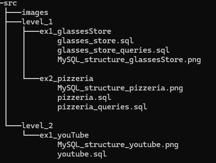

# MySQL - Structure

El objetivo de este proyecto es aprender a diseñar bases de datos relacionales, crear tablas y relaciones entre ellas, insertar datos de prueba y realizar consultas SQL.

## Estructura del proyecto



## Tecnologías

* MySQL 8.0 
* MySQL Workbench
* Docker Compose
* IntelliJ IDEA
* GitHub

## Instalación y Ejecución

1. Clona el repositorio
2. Ejecuta:
   ```docker compose up -d```

3. Conéctate con MySQL Workbench:
    * Host: `localhost`
    * Puerto: `3307`
    * Usuario: `root`
    * Contraseña: `mysqldocker`

4. Abre el archivo `.sql` de cada ejercicio en Workbench y ejecútalo (icono del rayo). 

Tambien puedes hacerlo desde la terminal:

Para glasses store:
```
docker exec -i mysql-ejercicios mysql -u root -p < level_1/ex1_glassesStore/glassesStore.sql
```

Para pizzeria:
```
docker exec -i mysql-ejercicios mysql -u root -p < level_1/ex2_pizzeria/pizzeria.sql
```

Para youTube:
```
docker exec -i mysql-ejercicios mysql -u root -p < level_2/ex1_youTube/youtube.sql
```


## Nivel 1

### Ejercicio 1 - Glasses Store

Se crea una base de datos para gestionar una óptica.

Se modelan proveedores, marcas, gafas, clientes, empleados y ventas, estableciendo las relaciones entre las diferentes entidades.

En `glasses_store_queries.sql`, hay consultas para:

* Obtener el total de ventas de un cliente durante un periodo.
* Obtener los diferentes modelos de gafas vendidos por un empleado durante un año.
* Obtener los diferentes proveedores de las gafas vendidas.

### Ejercicio 2 - Pizzeria

Se crea una base de datos para gestionar una pizzería.

Se modelan provincias, localidades, clientes, restaurantes, empleados, pedidos, productos y categorías de productos.

En `pizzeria_queries.sql`, hay consultas para:

* Obtener la cantidad de productos de una categoría vendidos en una determinada localidad.
* Obtener el número de pedidos asociados a un determinado empleado.

## Nivel 2

### Ejercicio 1 - YouTube

Se crea una base de datos para representar el funcionamiento de una plataforma de vídeos.

Se modelan usuarios, canales, vídeos, suscripciones, playlists, comentarios y otras entidades para poder hacer las relaciones entre ellas.